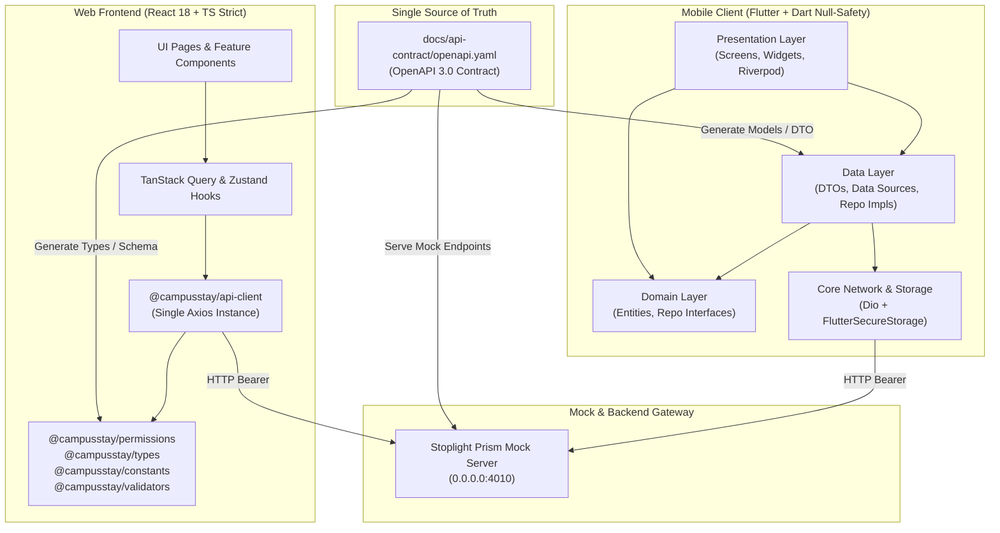

# KIẾN TRÚC HỆ THỐNG FRONTEND CAMPUSSTAY FPT
**Dự án:** Hệ thống Quản lý Ký túc xá & Sắp xếp Phòng – FPT University Tân Uyên (Bình Dương)  
**Vai trò:** Senior Frontend Architect  
**Phiên bản tài liệu:** 1.0.0

---

## 1. TỔNG QUAN HỆ THỐNG & TRIẾT LÝ THIẾT KẾ

CampusStay FPT là nền tảng quản lý lưu trú ký túc xá hiện đại dành riêng cho sinh viên và ban quản lý tại campus FPT University Tân Uyên (Bình Dương). Dự án được tổ chức theo mô hình **Monorepo** bao gồm 2 ứng dụng client:
1. **Web Portal (React 18 + TypeScript strict + Vite):** Phục vụ toàn diện cả 4 đối tượng: Sinh viên (Student), Cán bộ KTX (Staff), Trưởng ban KTX (Manager), và Quản trị viên (Admin).
2. **Mobile App (Flutter + Dart null-safety):** Ứng dụng di động tối ưu trải nghiệm nhanh, tiện lợi dành riêng cho **Sinh viên (Student)**.

---

## 2. TẠI SAO CHIA SẺ OPENAPI CONTRACT MÀ KHÔNG CHIA SẺ CODE?

Một câu hỏi cốt lõi từ Hội đồng giám khảo: *“Tại sao Web và Mobile trong cùng Monorepo lại không chia sẻ code (code sharing)?”*

### Quyết định Kiến trúc:
1. **Môi trường & Ngôn ngữ khác biệt (Heterogeneous Stacks):**
   - Web chạy trên JavaScript/TypeScript runtime (V8 / trình duyệt).
   - Mobile chạy trên Dart native compiled (AOT native cho Android/iOS).
   - Việc cố gắng chia sẻ code (như qua Kotlin Multiplatform hoặc WebAssembly) sẽ tạo ra tầng trung gian cồng kềnh, khó debug và giới hạn khả năng tận dụng hệ sinh thái phong phú của cả React lẫn Flutter.
2. **OpenAPI 3.0 là Single Source of Truth:**
   - Thay vì chia sẻ code, hai bên chia sẻ **Hợp đồng giao tiếp (API Contract)** tại `docs/api-contract/openapi.yaml`.
   - Web sinh type TypeScript bằng `openapi-typescript` hoặc interface bám sát schema.
   - Mobile sinh model Dart/Freezed chuẩn null-safety bám sát schema.
   - Mọi thay đổi về dữ liệu nghiệp vụ đều được đồng bộ hóa từ một file YAML duy nhất, loại bỏ hoàn toàn nguy cơ lệch pha (drift) giữa 2 nền tảng.
3. **Decoupled Release Cycle (Chu kỳ phát hành độc lập):**
   - Web triển khai tức thì (Continuous Deployment qua Web Server).
   - Mobile phải trải qua quy trình build APK/IPA, review của Google Play và Apple App Store. Tách biệt code giúp tránh tình trạng một thay đổi nhỏ của web làm vỡ pipeline của mobile và ngược lại.

---

## 3. PHÂN VAI TRÒ & GIẢI TRÌNH BỔ SUNG ACTOR "MANAGER"

Hệ thống hỗ trợ 4 Roles:

| Role | Nền tảng | Trách nhiệm chính |
|---|---|---|
| **STUDENT** | Web & Mobile | Đăng ký KTX, duyệt sơ đồ phòng, ghép nhóm bạn bằng mã PIN, ký hợp đồng số, quét VietQR đóng tiền, báo hỏng, check-in. |
| **STAFF** | Web | Quản lý tồn kho phòng/giường, thẩm định đơn đăng ký, xếp phòng thủ công, đổi phòng, nghiệm thu nhận/trả phòng, bảo trì, phát thông báo. |
| **MANAGER** | Web | Phê duyệt đơn ngoại lệ, thẩm định & duyệt kết quả xếp phòng tự động hàng loạt, báo cáo công suất & hiệu suất staff. |
| **ADMIN** | Web | Cấu hình kỳ học, luật ưu tiên, bảng giá, cấu hình engine xếp phòng, tích hợp SIS & VietQR, quản lý tài khoản & audit log. |

> **Giải trình Kiến trúc về Actor MANAGER:**  
> Trong tài liệu đề tài đăng ký ban đầu chỉ có 3 Actor (*Student, Staff, Admin*).  
> **MANAGER được bổ sung trong kiến trúc này nhằm tách biệt dứt điểm thẩm quyền duyệt cấp cao (Approval Authority) khỏi công việc vận hành hàng ngày (Daily Operations) của Staff.**  
> - Cán bộ Staff chỉ tập trung vào nghiệp vụ thực địa (thẩm định theo barem điểm có sẵn, lập biên bản, kiểm kê, bàn giao chìa khóa).
> - Các quyết định mang tính chiến lược hoặc ngoại lệ pháp lý (phê duyệt đơn diện khó khăn không đủ điểm, phê duyệt áp dụng kết quả phân bổ hàng trăm sinh viên từ thuật toán xếp phòng) bắt buộc phải do cấp Quản lý (Trưởng ban KTX/Ban Giám hiệu) ký duyệt điện tử.

---

## 4. CHI TIẾT TẦNG KIẾN TRÚC MỖI NỀN TẢNG

### 4.1. Kiến trúc Web (React 18 + TS Strict)
Áp dụng mô hình **Feature-Driven Architecture**:
- `Page`: File cực mỏng (< 60 dòng), đóng vai trò entry point cho Route, không chứa business logic.
- `Feature Component`: Xử lý giao diện của từng domain (ví dụ form đăng ký, thẻ nhóm bạn).
- `Feature Hooks`: Tích hợp TanStack Query (`useQuery`, `useMutation`) và Zustand.
- `packages/api-client`: Thư viện Axios duy nhất gắn Bearer token, interceptor chặn lỗi 401/403 và chuẩn hóa về kiểu `AppError`.
- `packages/permissions`: Nguồn sự thật phân quyền, kiểm tra bằng hàm `can()`, hook `usePermission()` và component `<Can>`.

### 4.2. Kiến trúc Mobile (Flutter + Dart Null-Safety)
Áp dụng mô hình **Clean Architecture 3 lớp**:
- `Presentation Layer`:
  - `Screens` (màn hình mỏng, điều hướng bằng `go_router`).
  - `Widgets` (chia nhỏ < 150 dòng, tách biệt StatelessWidget).
  - `State` (Riverpod `AsyncValue` tự động xử lý loading/data/error).
- `Domain Layer`:
  - `Entities` (Domain models thuần túy).
  - `Repository Interfaces` (Trừu tượng hóa việc truy xuất dữ liệu).
- `Data Layer`:
  - `DTOs` & Serializers (chuyển đổi JSON sang model).
  - `Remote Data Sources` (gọi HTTP qua `DioClient`).
  - `Repository Implementations`.
- `Core Layer`:
  - `SecureStorageService` dùng `FlutterSecureStorage` (lưu trữ mã hóa trên Keychain iOS & KeyStore Android, cấm dùng `SharedPreferences`).
  - `AppFailure` chuẩn hóa mọi ngoại lệ mạng, HTTP status thành thông điệp tiếng Việt thân thiện.

---

## 5. BẢO MẬT TOKEN & CƠ CHẾ ĐĂNG NHẬP

1. **Web:**
   - Hỗ trợ lưu trữ JWT an toàn, tự động đính kèm `Authorization: Bearer <token>` trên mỗi request.
   - Khi Backend trả về mã lỗi `401 Unauthorized`, interceptor lập tức kích hoạt `onUnauthorized()`, xóa session và điều hướng về trang `/login`.
2. **Mobile:**
   - Token được lưu vào `FlutterSecureStorage`. Tuyệt đối không dùng `SharedPreferences` cho token xác thực vì SharedPreferences lưu plain text trên disk của thiết bị đã root/jailbreak.
   - `go_router` thiết lập `redirect` bảo vệ: Chỉ sinh viên mới được vào app. Nếu tài khoản đăng nhập là Cán bộ/Quản trị viên, ứng dụng sẽ đăng xuất và điều hướng đến màn hình thông báo truy cập phiên bản Web.
