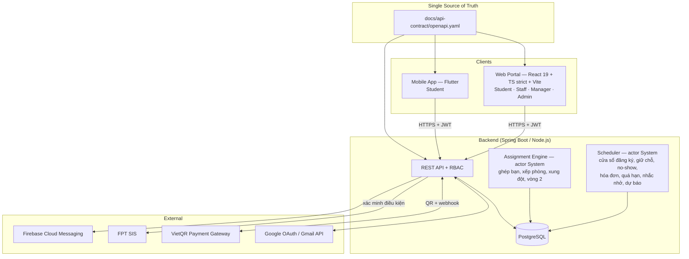

# KIẾN TRÚC HỆ THỐNG FRONTEND CAMPUSSTAY FPT
**Đề tài:** CampusStay FPT – Hệ thống quản lý đăng ký ký túc xá và sắp xếp phòng tại cơ sở Tân Uyên (Bình Dương) của Đại học FPT
**Mã đề tài:** FA26SE260 · GVHD: Thân Thị Ngọc Vân · Thời gian: 09/2026 – 03/2027
**Phiên bản tài liệu:** 2.0 (17/10/2026)

Tài liệu liên quan: [CONVENTIONS.md](CONVENTIONS.md) · [BUSINESS_FLOWS.md](BUSINESS_FLOWS.md) · [PERMISSION_MATRIX.md](PERMISSION_MATRIX.md) · [GAP_ANALYSIS.md](GAP_ANALYSIS.md) · [api-contract/openapi.yaml](api-contract/openapi.yaml)

**Nguồn yêu cầu:** Use Case Diagram v2 — [`diagrams/usecase-diagram-v2.webp`](diagrams/usecase-diagram-v2.webp) (bản mới nhất, ưu tiên cao nhất) · Phiếu đăng ký FA26SE260 · Activity/State/Context Diagram · ERD F0–F6.

---

## 1. PHẠM VI ĐỀ TÀI

### 1.1. Trong phạm vi
CampusStay FPT sở hữu toàn bộ nghiệp vụ **riêng của KTX**: đăng ký lưu trú theo kỳ, tồn kho tòa/tầng/phòng/giường, xếp phòng (tự động + thủ công), hợp đồng lưu trú số, thu phí phòng qua VietQR, đổi phòng, check-in/check-out, bảo trì – kiểm tra phòng, thông báo và báo cáo.

### 1.2. Ngoài phạm vi (theo Phiếu đăng ký)
- **Không** thay thế hệ thống thông tin sinh viên trung tâm (FPT SIS) — chỉ đọc dữ liệu để xác minh điều kiện.
- **Không** thu học phí. Thu phí giới hạn ở **phí phòng/giường** (tiền cọc + phần còn lại). Hóa đơn điện/nước là **mở rộng (Flow 6)**, làm sau khi các flow chính hoàn tất.
- **Không** quản lý thiết bị phần cứng (cửa từ, camera, công tơ thông minh) — chỉ ghi nhận dữ liệu do cán bộ nhập.

### 1.3. Sản phẩm bàn giao
| # | Sản phẩm | Người dùng | Công nghệ |
|---|---|---|---|
| 1 | Ứng dụng tự phục vụ cho sinh viên | Student | Web (React) + Mobile (Flutter) |
| 2 | Web quản lý vận hành KTX | Staff, Manager | Web (React) |
| 3 | Dashboard quản trị & báo cáo | Admin | Web (React) |

---

## 2. TÁC NHÂN (ACTOR) & TRÁCH NHIỆM

Bám theo **Use Case Diagram v2** (4 actor người dùng + actor **System**). Phiếu đăng ký liệt kê 3 actor; actor **Manager** được tách ra từ “Dormitory Staff” trong giai đoạn phân tích yêu cầu (P2) để phân định rõ **người thao tác** và **người phê duyệt**. Actor **System** đại diện các tác vụ tự động mà Phiếu yêu cầu ở mục *Intelligent Assignment and Occupancy Engine*.

| Actor | Nền tảng | Trách nhiệm (theo Use Case v2) |
|---|---|---|
| **Student** | Web + Mobile | Nộp đơn đăng ký (kiểm tra điều kiện, đóng cọc, chọn loại phòng; tùy chọn chọn bạn cùng phòng) · xem kết quả xếp phòng · xem & thanh toán hóa đơn · yêu cầu đổi phòng / hoán đổi chéo · phản hồi lời mời hoán đổi · báo hỏng · theo dõi trạng thái yêu cầu · tự check-in/check-out kèm biên bản hiện trạng số · xem thông báo · xem lịch bảo trì |
| **Staff** | Web | Rà soát đơn đăng ký · cập nhật trạng thái phòng/giường · **rà soát & điều chỉnh đề xuất xếp phòng** · xử lý yêu cầu bảo trì · lên lịch & thực hiện kiểm tra phòng · ghi nhận theo dõi bảo trì · **check-in thủ công / trễ hạn** · xác minh hiện trạng khi trả phòng · gửi thông báo |
| **Manager** | Web | Phê duyệt/từ chối đơn đăng ký · duyệt đề xuất xếp phòng · duyệt/từ chối đổi phòng · duyệt lịch bảo trì định kỳ · giám sát công suất & vận hành · xem báo cáo tài chính & vận hành |
| **Admin** | Web | Quản lý tài khoản & vai trò · cấu hình kỳ học · luật điều kiện · giá phòng/giường · luật & trọng số xếp phòng · giám sát engine · báo cáo công suất, doanh thu, luân chuyển · quản lý tích hợp SIS |
| **System** | Backend (scheduler + engine) | Mở/đóng cửa sổ đăng ký · gửi email mời đăng ký · nhả giữ chỗ hết hạn · hủy đơn chưa đóng cọc · chốt ghép bạn cùng phòng · chạy thuật toán xếp phòng · phát hiện xung đột · mở vòng 2 & lấp chỗ · hủy no-show & giữ cọc · tạo hóa đơn · đánh dấu hóa đơn quá hạn · gửi nhắc nhở tự động · dự báo công suất |

**Hệ thống ngoài** (theo Context Diagram): **Google** (xác thực tài khoản @fpt.edu.vn + gửi email) · **Payment Gateway** (VietQR / NAPAS 247, webhook xác nhận) · **FPT SIS** (xác minh tình trạng học tập — yêu cầu Interoperability của Phiếu).

---

## 3. KIẾN TRÚC TỔNG THỂ



**Vì sao Web và Mobile chia sẻ hợp đồng API thay vì chia sẻ code?** Hai runtime khác nhau (V8 vs Dart AOT); chia sẻ code tạo tầng trung gian khó debug. `openapi.yaml` là nguồn sự thật duy nhất: Web sinh type TypeScript, Mobile sinh model Dart, Prism dựng mock server — tránh lệch pha dữ liệu, và hai nền tảng phát hành độc lập.

---

## 4. KIẾN TRÚC TỪNG NỀN TẢNG

### 4.1. Web (React 19 + TypeScript strict)
```
apps/web/src/
├─ app/          router (lazy theo vai trò), layouts (Header, Sidebar), guards (RequireAuth, RequirePermission)
├─ features/     <domain>/{components, hooks, mocks.ts, index.ts}  — auth, application, assignment, invoice, …
├─ pages/        student/ staff/ manager/ admin/  — mỗi route một file Page
└─ shared-ui/    design tokens + component dùng chung (xem CONVENTIONS §8)
packages/        api-client · constants · permissions · types · validators
```
- **State server:** TanStack Query (cache, retry, optimistic update). **State client:** Zustand (phiên đăng nhập, tùy chọn giao diện).
- **Form:** react-hook-form + zod (`@campusstay/validators`) — cùng schema kiểm tra ở client và mô tả ở OpenAPI.
- **Phân quyền:** `can()`, `usePermission()`, `<Can>`, `<RequirePermission>` đọc từ `packages/permissions`.

### 4.2. Mobile (Flutter, chỉ dành cho Student)
Clean Architecture 3 lớp: Presentation (Screen, Widget, Riverpod `AsyncValue`) → Domain (Entity, Repository interface) → Data (DTO, DataSource, Repository impl) → Core (`DioClient`, `FlutterSecureStorage`). Tài khoản không phải Student đăng nhập sẽ được đăng xuất và chuyển tới màn hình hướng dẫn dùng Web.

---

## 5. SƠ ĐỒ TRANG (SITEMAP) — VỪA ĐỦ, KHÔNG DƯ

Nguyên tắc: **một trang = một nhóm use case liên quan**; các use case cùng đối tượng dữ liệu gom vào Tabs. Use case của actor **System** không có trang riêng — kết quả của chúng hiển thị trong trang nghiệp vụ tương ứng (ví dụ: đồng hồ giữ chỗ ở trang Đăng ký, cảnh báo xung đột ở trang Duyệt xếp phòng, dự báo ở trang Báo cáo). Tổng **29 trang** (6 Student + 2 dùng chung + 8 Staff + 4 Manager + 9 Admin). Chi tiết chênh lệch so với code hiện tại xem [GAP_ANALYSIS.md](GAP_ANALYSIS.md).

**Thông báo có hai loại, tách biệt:**
- **Thông báo cá nhân** — chuông trên Header, cạnh thông tin người dùng: chỉ những gì liên quan trực tiếp tới người đó hoặc phòng của họ (kết quả xếp phòng, lời mời hoán đổi, hóa đơn sắp đến hạn, lịch sửa thiết bị).
- **Thông báo chung** — trang `/notifications`, mọi vai trò truy cập từ cuối Sidebar: thông báo hệ thống diện rộng do Quản trị viên cấu hình hoặc Ban quản lý KTX gửi.

### 5.0. Dùng chung — 2 trang
| Trang | Route | Nội dung |
|---|---|---|
| Thông báo chung | `/notifications` | View Notifications (thông báo hệ thống) |
| Hồ sơ cá nhân | `/profile` (mở từ menu tài khoản) | Sinh viên: hồ sơ đồng bộ SIS; vai trò khác: thông tin tài khoản. Có cài đặt nhận thông báo |

### 5.1. Student — 6 trang
| Trang | Route | Use case phủ |
|---|---|---|
| Tổng quan | `/student/dashboard` | Việc cần làm, tiến trình đơn (Track Request Status), thông báo chung mới nhất |
| Đăng ký lưu trú | `/student/registration` | Submit Dormitory Application: Validate Eligibility → thời gian lưu trú → Select Room Types → Select Roommate (chỉ phòng 2 người) → xác nhận chi phí → Pay Deposit |
| Phòng của tôi | `/student/my-room` | View Room Assignment, tài sản trong phòng (mã ID, báo hỏng), bạn cùng phòng, lịch lưu trú, hợp đồng số |
| Hóa đơn & thanh toán | `/student/invoices` | View Payment, Pay Invoice (chỉ VietQR) |
| Yêu cầu | `/student/requests` | Submit Room Change Request, Initiate Mutual Swap, Respond to Swap Invitation, Submit Maintenance Request (chọn tài sản theo mã), Track Request Status, View Maintenance Schedule |
| Check-in / Check-out | `/student/checkin` | Self Check-in, Self Check-out, Submit Digital Room-Condition Report |

Không có trang tra cứu phòng/giường trống cho sinh viên — sơ đồ phòng và tình trạng giường là dữ liệu vận hành nội bộ. Sinh viên chỉ thấy **3 loại phòng** (2, 4, 6 người) kèm hình minh họa, tiện nghi và mức còn chỗ (Còn chỗ / Sắp hết / Hết chỗ), không thấy số lượng cụ thể.

### 5.2. Staff — 8 trang
| Trang | Route | Use case phủ |
|---|---|---|
| Tổng quan | `/staff/dashboard` | Việc cần làm trong ngày, tiến độ check-in thời gian thực |
| Phòng & giường | `/staff/inventory` | Update Room & Bed Status |
| Đơn đăng ký | `/staff/applications` | Review Dormitory Applications (đơn bị gắn cờ, chuyển Manager) |
| Xếp phòng | `/staff/assignment` | Review / Adjust Room Assignment Proposal (cảnh báo xung đột, điều chỉnh thủ công, danh sách vòng 2) |
| Đổi phòng | `/staff/room-changes` | Theo dõi & rà soát đơn đổi phòng trước khi Manager quyết định (không có use case riêng — gộp được vào Tổng quan nếu cần tinh gọn) |
| Check-in / Check-out | `/staff/checkin-out` | Process Manual / Late Check-in, Verify Room Condition at Check-out, danh sách sắp no-show |
| Bảo trì & kiểm tra | `/staff/maintenance` | Handle Maintenance Requests, Schedule Room Inspections, Inspect Room/Equipment, Record Maintenance Follow-ups |
| Thông báo | `/staff/broadcast` | Communicate with residents (in-app, email, SMS) |

### 5.3. Manager — 4 trang
| Trang | Route | Use case phủ |
|---|---|---|
| Tổng quan vận hành | `/manager/dashboard` | Monitor Dormitory Occupancy & Operations |
| Trung tâm phê duyệt | `/manager/approvals` | Approve/Reject Dormitory Applications, Approve/Reject Room Change Requests, Approve Periodic Maintenance Schedules (3 tab) |
| Duyệt xếp phòng | `/manager/assignment-approval` | Review/Approve Room Assignment Proposals (kèm cảnh báo xung đột từ System) |
| Báo cáo | `/manager/reports` | Review Financial & Operation Reports |

### 5.4. Admin — 9 trang
| Trang | Route | Use case phủ |
|---|---|---|
| Tổng quan hệ thống | `/admin/dashboard` | Sức khỏe hệ thống, tích hợp, kỳ học đang chạy |
| Kỳ học | `/admin/semesters` | Configure Academic Terms (mốc mở/đóng cửa sổ đăng ký, hạn cọc, thời hạn giữ chỗ, khung check-in — đầu vào cho actor System) |
| Luật điều kiện | `/admin/rules` | Configure Eligibility Rules (năm học, ngành, khoảng cách) |
| Loại phòng & giá | `/admin/pricing` | Configure Room & Bed Pricing |
| Engine xếp phòng | `/admin/allocation-engine` | Configure Assignment Rules & Priorities, Monitor Assignment Engine (lịch sử chạy, xung đột) |
| Tích hợp | `/admin/integrations` | Quản lý kết nối FPT SIS, VietQR, Google |
| Người dùng & vai trò | `/admin/users` | Manage User Accounts & Roles |
| Báo cáo | `/admin/reports` | Generate Occupancy, Revenue & Turnover Reports; hiển thị Forecast Occupancy Trends (System) |
| Nhật ký kiểm toán | `/admin/audit-logs` | Yêu cầu phi chức năng: truy vết theo NĐ 13/2023 |

---

## 6. KIẾN TRÚC ĐÁP ỨNG YÊU CẦU PHI CHỨC NĂNG

| Yêu cầu (Phiếu §3.2.d) | Giải pháp kiến trúc | Tiêu chí kiểm thử |
|---|---|---|
| **Bảo mật & quyền riêng tư** (NĐ 13/2023/NĐ-CP) | Đăng nhập Google OAuth giới hạn domain `fpt.edu.vn`; JWT ngắn hạn (15 phút) + refresh token; RBAC 4 vai trò kiểm tra ở Backend; mã hóa TLS 1.2+ khi truyền, AES-256 cho trường nhạy cảm (CCCD, SĐT, STK hoàn cọc) khi lưu; che dữ liệu khi hiển thị; audit log bất biến cho mọi thao tác ghi & xuất dữ liệu; thu thập đồng ý xử lý dữ liệu cá nhân khi đăng ký lần đầu | 100% API ghi có kiểm tra quyền; không có PII trong log/URL; pentest OWASP Top 10 cơ bản |
| **Khả năng mở rộng** (4.000 sinh viên) | API stateless chạy nhiều instance sau load balancer; PostgreSQL có index theo `term_id`, `status`, `student_id`; phân trang server; engine xếp phòng chạy nền theo batch, không chặn request; Docker để nhân bản | Tải thử 500 người dùng đồng thời giờ mở cổng: p95 API < 800 ms; engine xếp 4.000 đơn < 5 phút |
| **Khả năng cấu hình** | Kỳ học, luật điều kiện, loại phòng, bảng giá, trọng số engine lưu trong bảng cấu hình, chỉnh qua trang Admin — không cần build lại; luật có phiên bản để quay lui | Đổi giá / luật có hiệu lực ngay cho đơn mới, không deploy |
| **Khả năng tích hợp** | Adapter riêng cho FPT SIS (xác minh điều kiện), VietQR (tạo QR động + webhook có chữ ký), Google (OAuth + Gmail API), FCM (push mobile); retry có backoff; trang Tích hợp hiển thị trạng thái | Webhook idempotent theo `transaction_ref`; SIS lỗi không chặn sinh viên xem dữ liệu đã có |

Yêu cầu bổ sung cho trải nghiệm: chunk JS khởi tạo ≤ 250 KB gzip, LCP ≤ 2,5 s trên 4G, giao diện dùng được từ 360 px, mọi nội dung tiếng Việt.

---

## 7. XÁC THỰC & PHIÊN LÀM VIỆC

1. Trang đăng nhập có 2 tab:
   - **Student** — “Sign in with Google” hoặc “Sign in with FEID” (tài khoản `@fpt.edu.vn`, đồng bộ từ FPT SIS).
   - **Staff / Admin** — tài khoản & mật khẩu do Quản trị viên cấp (Staff, Manager, Admin).
2. Vai trò được xác định từ tài khoản sau khi đăng nhập; giao diện chỉ hiển thị chức năng của đúng vai trò đó. **Không có** chế độ chọn/chuyển vai trò trong ứng dụng.
3. Backend trả `access token` (15 phút) + `refresh token` (httpOnly cookie, 7 ngày).
4. **Web:** access token giữ trong bộ nhớ (Zustand), không lưu PII; `401` → thử refresh một lần → thất bại thì về `/login`.
5. **Mobile:** token trong `FlutterSecureStorage` (Keychain / Keystore), cấm `SharedPreferences`.
6. **Môi trường phát triển (chưa nối Backend):** tài khoản mẫu `student`, `staff`, `manager`, `admin` — mật khẩu `123` (`apps/web/src/features/auth/mockAccounts.ts`). File này bị thay bằng `POST /auth/login` khi nối API.
