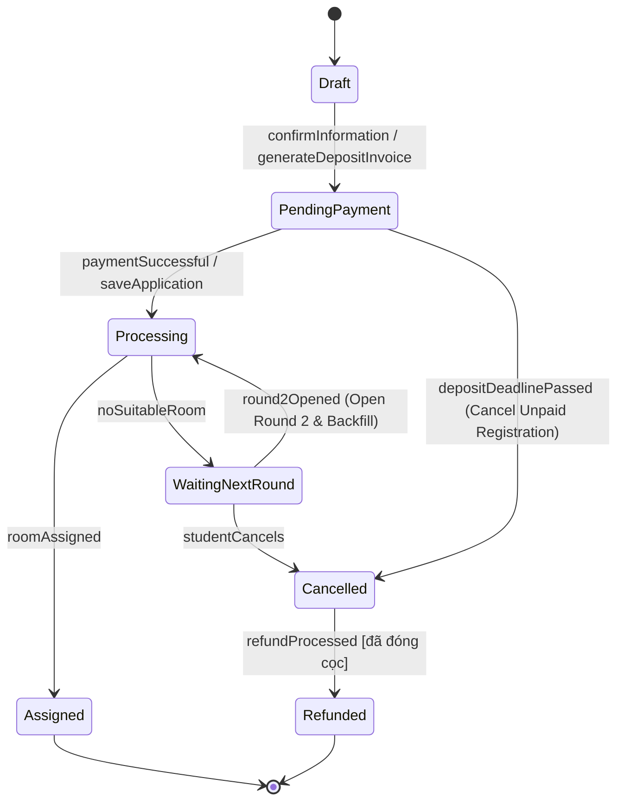
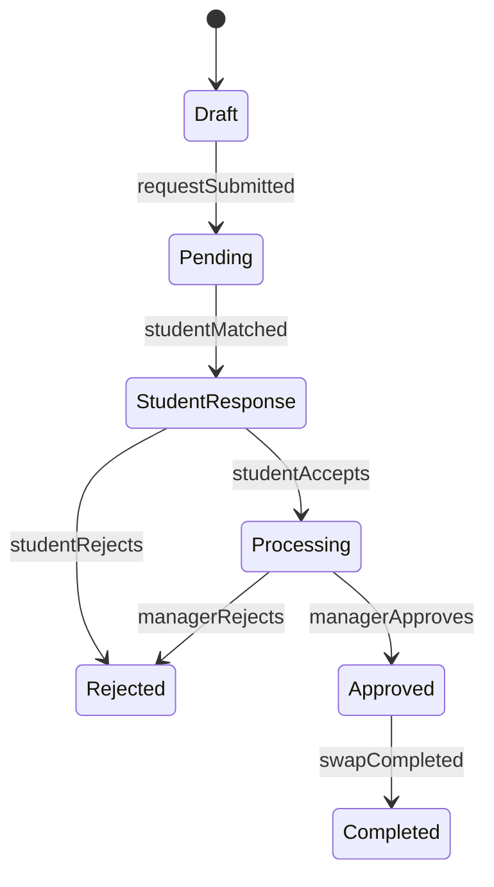
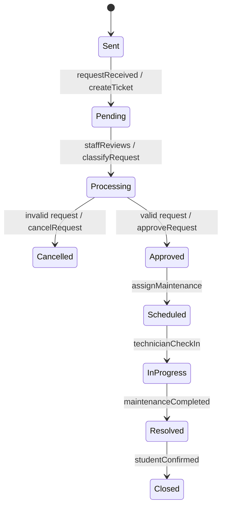

# LUỒNG NGHIỆP VỤ & MÁY TRẠNG THÁI
**CampusStay FPT** · **Phiên bản:** 2.0 (17/10/2026)

## Nguồn tài liệu (theo thứ tự ưu tiên khi mâu thuẫn)
1. **Use Case Diagram v2** — [`diagrams/usecase-diagram-v2.webp`](diagrams/usecase-diagram-v2.webp) *(bản mới nhất, 5 actor: Student, Staff, Manager, Admin, System)*
2. State Diagram: đơn đăng ký, đơn đổi phòng, yêu cầu sửa chữa
3. Activity Diagram các luồng chính: Đăng ký, Xếp phòng, Check-in, Hoán đổi phòng, Bảo trì, Thanh toán phí KTX
4. Context Diagram · ERD theo flow (F0–F6)
5. Phiếu đăng ký đồ án FA26SE260

> Khi Activity Diagram cũ khác Use Case v2, **Use Case v2 được ưu tiên**; các điểm khác biệt được ghi ở cuối mỗi flow (mục *Điều chỉnh theo Use Case v2*) và cần cập nhật lại sơ đồ gốc.

---

## 0. DANH SÁCH USE CASE THEO ACTOR (Use Case v2)

| Actor | Use case |
|---|---|
| **Student** (12) | Submit Dormitory Application (*include* Validate Eligibility, Pay Deposit, Select Room Types · *extend* Select Roommate) · View Room Assignment · View Payment · Pay Invoice · Submit Room Change Request (*extend* Initiate Mutual Room Swap) · Respond to Swap Invitation · Submit Maintenance Request · Track Request Status · Self Check-in · Self Check-out (*cả hai include* Submit Digital Room-Condition Report) · View Notifications · View Maintenance Schedule |
| **Staff** (9) | Review Dormitory Applications · Update Room & Bed Status · Review / Adjust Room Assignment Proposal · Handle Maintenance Requests · Schedule Room Inspections · Inspect Room / Equipment · Record Maintenance Follow-ups · Process Manual / Late Check-in · Verify Room Condition at Check-out |
| **Manager** (6) | Approve / Reject Dormitory Applications · Review / Approve Room Assignment Proposals · Approve / Reject Room Change Requests · Approve Periodic Maintenance Schedules · Monitor Dormitory Occupancy & Operations · Review Financial & Operation Reports |
| **Admin** (7) | Manage User Accounts & Roles · Configure Academic Terms · Configure Eligibility Rules · Configure Room & Bed Pricing · Configure Assignment Rules & Priorities · Monitor Assignment Engine · Generate Occupancy, Revenue & Turnover Reports |
| **System** (13) | Open / Close Registration Window · Send Registration Invitation Email · Release Expired Room Hold · Finalize Roommate Matching · Execute Room Assignment Algorithm · Cancel Unpaid Registration · Detect Assignment Conflicts · Forecast Occupancy Trends · Send Automated Reminders · Cancel No-show & Forfeit Deposit · Mark Overdue Invoices · Generate Invoice · Open Round 2 & Backfill Students |

---

## F0. Đăng nhập
- Đăng nhập bằng **Google** (tài khoản `@fpt.edu.vn`); hệ thống ánh xạ email → vai trò.
- Student được tạo/cập nhật từ FPT SIS (mã SV, giới tính, ngành, năm học, tỉnh thường trú, tình trạng học tập).
- Email gửi qua Google (Gmail API) — Context Diagram.

---

## F1. Đăng ký lưu trú

**Do hệ thống khởi động**
- **Open / Close Registration Window:** mở/đóng cổng đăng ký tự động theo mốc thời gian Admin cấu hình cho kỳ học.
- **Send Registration Invitation Email:** khi cổng mở, gửi email mời đăng ký tới sinh viên đủ điều kiện (theo dữ liệu SIS và luật điều kiện).

**Sinh viên thực hiện**
1. Hệ thống tính **sức chứa còn lại** theo loại phòng.
2. Chọn **thời gian lưu trú** (kỳ học).
3. **Chọn loại phòng** (*include* — bắt buộc). Giường tương ứng được **giữ chỗ có thời hạn** (`BED_STATUS.RESERVED`).
4. **Chọn bạn cùng phòng** (*extend* — tùy chọn):
   - Có bạn sẵn: nhập **mã sinh viên** → hệ thống gửi **email xác nhận** cho bạn đó.
   - Chưa có: chọn tiêu chí ghép **vùng/quê quán, học kỳ, ngành**.
5. Xác nhận thông tin → **Validate Eligibility** (*include*) theo luật Admin cấu hình → tạo **hóa đơn tiền cọc**.
6. **Pay Deposit** (*include*): hiển thị **VietQR** → sinh viên quét & chuyển khoản → webhook xác nhận → **lưu đơn** (*Processing*).

**Tác vụ hệ thống liên quan**
- **Release Expired Room Hold:** hết thời hạn giữ chỗ mà chưa đóng cọc → nhả giường về `AVAILABLE`.
- **Cancel Unpaid Registration:** quá hạn đóng cọc → đơn chuyển *Cancelled* (không phát sinh phí).
- **Send Automated Reminders:** nhắc đóng cọc trước khi hết hạn giữ chỗ.

**Rà soát & phê duyệt**
- Staff **Review Dormitory Applications** — xử lý đơn bị gắn cờ (điều kiện chưa rõ, dữ liệu SIS lệch, lý do đặc biệt).
- Manager **Approve / Reject Dormitory Applications** — quyết định với các trường hợp Staff chuyển lên.

**Quy tắc:** tối đa 1 đơn hiệu lực / sinh viên / kỳ; luật điều kiện (năm học, ngành, khoảng cách, tình trạng học tập) cấu hình được, không hard-code.

Hằng số: `APPLICATION_STATUS` = `DRAFT · PENDING_PAYMENT · PROCESSING · WAITING_NEXT_ROUND · ASSIGNED · CANCELLED · REFUNDED`.

---

## F2. Xếp phòng & giường

1. **Finalize Roommate Matching** (System): chốt các cặp/nhóm bạn cùng phòng đã xác nhận qua email; ghép theo tiêu chí cho sinh viên chưa có bạn.
2. **Execute Room Assignment Algorithm** (System): ghép có trọng số trên các đơn đã đóng cọc theo luật ưu tiên Admin cấu hình (ngày nộp, loại phòng, yêu cầu bạn cùng phòng, ngành/năm học).
3. **Detect Assignment Conflicts** (System): giường gán hai lần, cặp bạn cùng phòng bị tách khác tòa, sai khu giới tính, vượt sức chứa → gắn cảnh báo vào đề xuất.
4. Staff **Review / Adjust Room Assignment Proposal**: rà soát cảnh báo, điều chỉnh thủ công các phân bổ có vấn đề, gửi Manager.
5. Manager **Review / Approve Room Assignment Proposals**: duyệt → tạo hợp đồng & thông báo sinh viên; từ chối → trả về Staff điều chỉnh.
6. Sinh viên chưa có phòng → *Waiting next round* → **Open Round 2 & Backfill Students** (System): mở vòng 2, lấp chỗ trống (từ no-show, hủy đơn). Sinh viên không đồng ý vòng 2 → hủy đơn & hoàn cọc.
7. Student **View Room Assignment**.

Proposal: `PENDING_APPROVAL → APPROVED | REJECTED`. Phân bổ: `ASSIGNED → CHECKED_IN → CHECKED_OUT` hoặc `NO_SHOW`.

*Điều chỉnh theo Use Case v2:* Activity Diagram cũ ghi “Staff manually allocate” khi Manager từ chối — nay hợp nhất thành **Review / Adjust Room Assignment Proposal** của Staff (cả trước và sau khi Manager phản hồi).

---

## F3. Check-in / Check-out

**Self Check-in (Student)**
1. Quét **mã QR check-in** → hệ thống kiểm tra **khung thời gian** và điều kiện.
2. Hợp lệ → **Pay Invoice** phần phí còn lại qua VietQR → thành công → phân bổ *Checked-in* → nhận thông tin truy cập phòng.
3. **Submit Digital Room-Condition Report** (*include*): báo sự cố & xác nhận hiện trạng tài sản → vào ở.

**Process Manual / Late Check-in (Staff)**
- Sinh viên ngoài khung thời gian, không quét được QR hoặc gặp sự cố → Staff xác minh và check-in thủ công.

**Cancel No-show & Forfeit Deposit (System)**
- Hết khung check-in mà sinh viên không check-in và không được Staff xử lý → phân bổ `NO_SHOW`, giường được giải phóng cho vòng 2, tiền cọc chuyển `FORFEITED`.

**Self Check-out (Student) & Verify Room Condition at Check-out (Staff)**
- Sinh viên nộp biên bản hiện trạng số khi trả phòng; Staff đối chiếu với biên bản nhận phòng, ghi nhận hư hỏng (khấu trừ cọc nếu có).

*Điều chỉnh theo Use Case v2:* Activity Diagram cũ có bước **Manager duyệt check-in trễ** — Use Case v2 chuyển thành **Staff xử lý check-in thủ công/trễ**, Manager không còn tham gia. Cần cập nhật lại sơ đồ *Luong_CheckIn_NoShow*.

---

## F4. Đổi phòng / hoán đổi phòng

1. Student A **Submit Room Change Request**; có thể *extend* **Initiate Mutual Room Swap** bằng cách nhập mã SV của Student B.
   - Không chỉ định đối tác → treo yêu cầu chờ ghép; hết thời hạn → hủy và thông báo.
   - Có đối tác → kiểm tra điều kiện & luật đổi phòng (cùng giới tính, cùng kỳ, đang ở, trong đợt cho phép).
2. Student B **Respond to Swap Invitation**: từ chối → *Rejected*; chấp nhận → chuyển xử lý.
3. Manager **Approve / Reject Room Change Requests**: duyệt → hoán đổi phân bổ, cập nhật phòng/giường và hợp đồng, thông báo hai bên; từ chối → *Rejected*.
4. Hai sinh viên **Self Check-out** phòng cũ và **Self Check-in** phòng mới (F3).
5. Student **Track Request Status** suốt quá trình.

Hằng số: `ROOM_CHANGE_STATUS`.

---

## F5. Bảo trì & kiểm tra phòng

1. Nguồn yêu cầu: Student **Submit Maintenance Request**, hoặc lịch **bảo trì định kỳ** do Manager **Approve Periodic Maintenance Schedules**. Student **View Maintenance Schedule** để biết lịch.
2. Hệ thống cập nhật trạng thái bảo trì của phòng/giường; Staff **Update Room & Bed Status** khi cần (giường hỏng không được xếp).
3. Staff **Handle Maintenance Requests** → **Schedule Room Inspections** → **Inspect Room / Equipment** → cần sửa thì thực hiện → **Record Maintenance Follow-ups**.
4. Hệ thống gỡ trạng thái bảo trì, cập nhật yêu cầu; Student **Track Request Status** và xác nhận hoàn tất.

Hằng số: `MAINTENANCE_STATUS`.

*Điều chỉnh theo Use Case v2:* Activity Diagram cũ đặt “Inspect Room / Equipment” trong lane Manager — theo Use Case v2 đây là việc của **Staff**.

---

## F6. Hóa đơn & thanh toán

1. **Generate Invoice** (System): đầu kỳ tự tạo hóa đơn phí KTX dựa trên giường đã gán; gửi thông báo + hạn thanh toán.
2. Student **View Payment** → **Pay Invoice** qua VietQR → webhook → *Đã thanh toán*, gửi biên nhận. Thất bại → giữ *Chưa thanh toán*, ghi log.
3. **Send Automated Reminders** (System): nhắc trước hạn và đúng hạn.
4. **Mark Overdue Invoices** (System): quá hạn → *Quá hạn*, gửi cảnh báo, chuyển Staff xử lý ngoại lệ công nợ.

**Mở rộng — điện/nước (ERD Flow 6):** Staff ghi chỉ số công tơ → hệ thống tạo đợt hóa đơn điện/nước. Làm sau khi các flow chính hoàn tất.

Loại hóa đơn `INVOICE_TYPE` = `DEPOSIT · ROOM_FEE · UTILITY`. Trạng thái `INVOICE_STATUS` = `UNPAID · PAID · OVERDUE · CANCELLED · REFUNDED · FORFEITED`.

---

## F7. Giám sát, báo cáo & cấu hình

| Use case | Actor | Nội dung |
|---|---|---|
| Configure Academic Terms | Admin | Kỳ học, mốc mở/đóng cổng, hạn đóng cọc, thời hạn giữ chỗ, khung check-in |
| Configure Eligibility Rules | Admin | Năm học, ngành, khoảng cách, tình trạng học tập |
| Configure Room & Bed Pricing | Admin | Loại phòng, giá giường, tiền cọc |
| Configure Assignment Rules & Priorities | Admin | Trọng số ưu tiên, ràng buộc cứng/mềm |
| Monitor Assignment Engine | Admin | Lịch sử chạy, kết quả, xung đột |
| Forecast Occupancy Trends | System | Dự báo công suất & giường trống mỗi kỳ |
| Monitor Dormitory Occupancy & Operations | Manager | Công suất, tiến độ check-in, yêu cầu tồn đọng |
| Review Financial & Operation Reports | Manager | Doanh thu, công nợ, vận hành |
| Generate Occupancy, Revenue & Turnover Reports | Admin | Xuất báo cáo theo kỳ |

---

## TÁC VỤ TỰ ĐỘNG CỦA ACTOR SYSTEM

| Use case System | Kích hoạt | Kết quả | Flow |
|---|---|---|---|
| Open / Close Registration Window | Mốc thời gian của kỳ học | Cửa sổ `SCHEDULED → OPEN → CLOSED` | F1 |
| Send Registration Invitation Email | Khi cửa sổ mở | Email mời tới sinh viên đủ điều kiện | F1 |
| Release Expired Room Hold | Hết thời hạn giữ chỗ | Giường `RESERVED → AVAILABLE` | F1 |
| Cancel Unpaid Registration | Quá hạn đóng cọc | Đơn `PENDING_PAYMENT → CANCELLED` | F1 |
| Finalize Roommate Matching | Trước khi chạy engine | Chốt cặp/nhóm bạn cùng phòng | F2 |
| Execute Room Assignment Algorithm | Theo lịch kỳ học | Tạo proposal `PENDING_APPROVAL` | F2 |
| Detect Assignment Conflicts | Mỗi lần tạo/điều chỉnh proposal | Cảnh báo xung đột | F2 |
| Open Round 2 & Backfill Students | Sau khi đóng vòng 1 / có giường trống | Đơn chờ vòng 2 được xếp lấp chỗ | F2 |
| Cancel No-show & Forfeit Deposit | Hết khung check-in | Phân bổ `NO_SHOW`, cọc `FORFEITED` | F3 |
| Generate Invoice | Đầu kỳ / khi được xếp phòng | Hóa đơn `ROOM_FEE` | F6 |
| Mark Overdue Invoices | Hằng ngày | Hóa đơn `UNPAID → OVERDUE` | F6 |
| Send Automated Reminders | Trước hạn cọc, hóa đơn, check-in/out | Email + in-app (+ push mobile) | F1, F3, F6 |
| Forecast Occupancy Trends | Mỗi kỳ, trước khi mở cổng | Biểu đồ dự báo trong Báo cáo | F7 |
